# DandEtudeDuR

App web para estudiar lectura rítmica, en honor a *Étude du Rythme* de Georges Dandelot.

Genera ritmos en partitura según el compás y las figuras que elijas, los reproduce con un metrónomo configurable y mide tu precisión cuando los tocas sobre la partitura (con el dedo o el ratón), con el teclado o, en el móvil, con un botón grande en la parte de abajo de la pantalla.

## Qué incluye

- **Práctica libre:** compases 2/4, 3/4, 4/4, 5/4, 2/2, 3/2, 3/8, 6/8, 9/8, 12/8, 5/8, 7/8 y 8/8 (en los de amalgama eliges la agrupación: 3+2 o 2+3; 2+2+3, 2+3+2 o 3+2+2; 3+3+2, 3+2+3 o 2+3+3); de 1 a 16 compases; redonda, blanca, negra, corchea y semicorchea (con y sin puntillo), tresillos, ritmo lombardo y dosillo (en compases compuestos).
- **Silencios a elección:** se eligen uno por uno, igual que las figuras: de redonda (sirve como silencio de compás entero en cualquier compás), blanca, negra, negra con puntillo, corchea y semicorchea.
- **Escritura según el pulso:** las figuras y los silencios se escriben sin tapar el pulso ni la mitad del compás, y las barras de las corcheas se agrupan por pulso (por blanca en 2/2 y 3/2).
- **Síncopas y ligaduras:** dos opciones independientes. Las notas ligadas no se vuelven a tocar.
- **Reproducir y metrónomo:** escucha el ritmo antes de tocarlo. Tempo de 30 a 240 ppm (en 6/8, 9/8 y 12/8 hasta 160, y en 2/2 y 3/2 hasta 120, lo mismo que negra = 240) con indicación italiana, acento, subdivisión, cuenta previa y marcado de tempo con toques.
- **Dos formas de tocar:** en **Piano** (la de por defecto) mantienes pulsada cada nota lo que dura y se mide tanto el ataque como cuándo la sueltas; en **Batería** solo cuenta el golpe, que suena como un redoblante. Se elige justo encima de *Practicar*.
- **Práctica con evaluación:** puedes oír tus propios toques, y los golpes de más se pueden penalizar o solo contar.
- **Resultados sobre la partitura:** cada nota muestra tu desvío, las notas sin tocar se marcan con una ✕ y los golpes de más con un triángulo en el lugar donde tocaste.
- **Análisis de tus toques:** regularidad, si aceleras o te retrasas, el error a tiempo, a contratiempo y tras un silencio, y un consejo concreto.
- **Para afianzar el pulso:** práctica en bucle que sube el tempo cuando llegas a la precisión elegida, y metrónomo que calla en algunos compases.
- **Medición de latencia:** calcula la corrección para tu equipo, por ejemplo con auriculares Bluetooth.
- **Campaña:** 39 niveles en 7 capítulos, del pulso en negras a las ligaduras, las síncopas y los compases compuestos y de amalgama, con estrellas y desbloqueo progresivo.
- **Mis ejercicios:** escribe tus propios ritmos figura a figura (o con una notación de texto), guárdalos y compártelos como archivo, texto o enlace.
- **Mi progreso:** historial de prácticas, gráfica de precisión y comparación con las prácticas anteriores.
- **Pensada también para el móvil:** la página sigue a la partitura mientras suena y, en pantallas táctiles, hay un botón flotante para tocar sin miedo a equivocarte de sitio, para detener lo que suena y, al terminar, para repetir o seguir.
- **Accesible y privada:** se puede usar entera con teclado y lector de pantalla, cumple los contrastes de WCAG 2.2 AA y no hace ninguna petición a otros sitios: todo, fuentes incluidas, va en el propio repositorio y tus datos se quedan en tu navegador (ver [`SECURITY.md`](SECURITY.md)).

## Uso

Abre `index.html` en el navegador. Necesita a su lado, en la misma carpeta, `styles.css` y las carpetas `js/` (el código de la app, en varios archivos) y `fonts/` (las tipografías); basta con abrirlo directamente (`file://`) o servir la carpeta con cualquier servidor web. No necesita instalación ni compilación. El progreso se guarda en el navegador.

## Cómo funciona

### 1. La pantalla principal

La primera vez, una tarjeta explica cómo se practica (incluida la forma de tocar: *Piano* o *Batería*) y presenta las demás pestañas (*Campaña*, *Mis ejercicios* y *Mi progreso*):

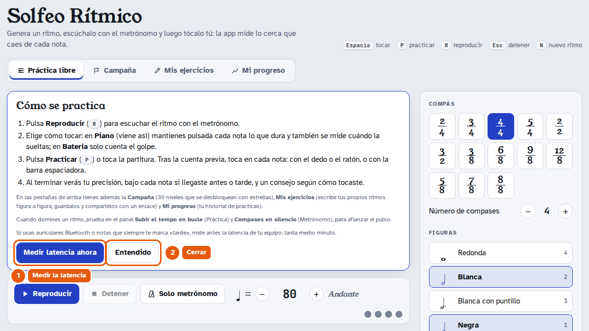

1. **Medir latencia ahora:** empieza la medición (recomendable con auriculares Bluetooth).
2. **Entendido:** cierra la tarjeta. También se cierra sola al terminar la primera práctica.

Después, la pantalla principal queda así:

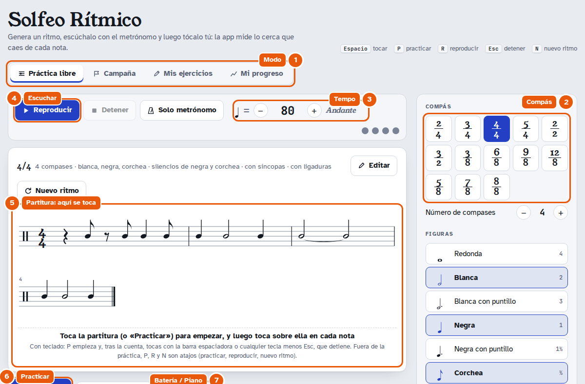

1. **Modo:** *Práctica libre* (tú eliges todo), *Campaña* (niveles guiados), *Mis ejercicios* (ritmos que escribes tú) o *Mi progreso*.
2. **Compás y opciones del ritmo:** en el panel de la derecha (debajo, en el móvil). Se explican en el apartado siguiente.
3. **Tempo:** con − / +, escribiendo el número o marcándolo con toques.
4. **Reproducir:** hace sonar el ritmo con el metrónomo para que lo oigas antes de practicarlo. *Nuevo ritmo* (o la tecla <kbd>N</kbd>) genera otro.
5. **Partitura:** además de leerla, es donde tocas. Tocarla en reposo también empieza la práctica.
6. **Practicar:** empieza la cuenta previa y la evaluación.
7. **Forma de tocar:** *Piano* (viene así) mide cuándo tocas cada nota y cuánto la mantienes pulsada; *Batería* solo cuándo la tocas, con sonido de redoblante.

### 2. Opciones del ritmo

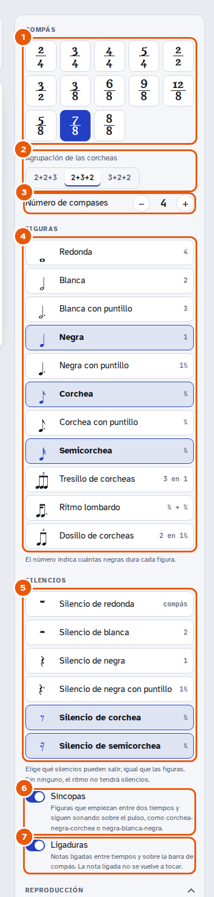

1. **Compás:** trece compases simples, compuestos y de amalgama.
2. **Agrupación:** solo en 5/8, 7/8 y 8/8. Cambia cómo se agrupan las corcheas; el metrónomo acentúa el inicio de cada grupo y las barras de las corcheas lo siguen.
3. **Número de compases:** de 1 a 16.
4. **Figuras:** pulsa para activar o desactivar cada una. El número de la derecha indica cuántas negras dura. Además de las figuras sueltas están el tresillo, el *ritmo lombardo* (semicorchea y corchea con puntillo) y el *dosillo de corcheas* (solo en compases compuestos).
5. **Silencios:** igual que las figuras, uno por uno. El de redonda vale como silencio de compás entero en cualquier compás. Si un silencio no se usa en el compás elegido o necesita figuras más cortas a su lado (el de semicorchea necesita semicorcheas), la app te avisa encima de la partitura.
6. **Síncopas:** figuras que empiezan entre dos tiempos y siguen sonando sobre el pulso, como corchea-negra-corchea o negra-blanca-negra.
7. **Ligaduras:** notas ligadas entre tiempos y sobre la barra de compás.

El resumen encima de la partitura recuerda siempre qué está activo. Un ejemplo con síncopas, ligaduras y silencios de semicorchea:

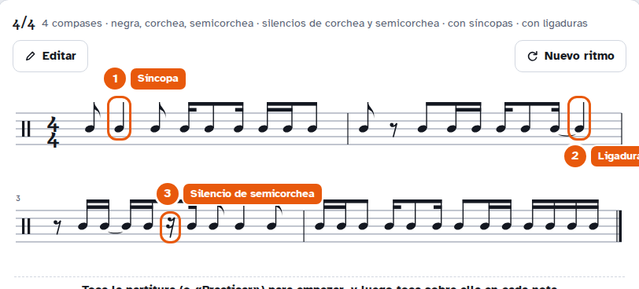

1. **Síncopa:** la negra empieza entre dos tiempos; tócala en el «y».
2. **Ligadura:** la segunda nota no se toca; alarga la anterior.
3. **Silencio de semicorchea:** un cuarto de tiempo sin tocar.

### 3. Sonido y práctica

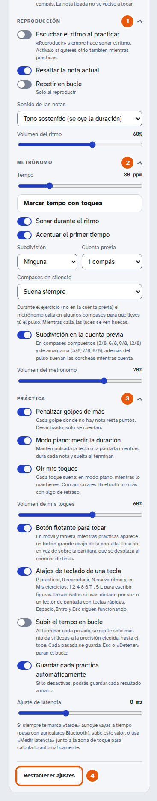

Las tres secciones se pliegan y despliegan pulsando su título (en el móvil empiezan plegadas); la app recuerda cómo las dejaste.

1. **Reproducción:** *Reproducir* siempre hace sonar el ritmo; *Escuchar el ritmo al practicar* lo hace sonar también mientras practicas (viene apagada, para que lo leas tú). También: resaltar la nota actual, repetir en bucle, sonido de las notas (tono sostenido o golpe de redoblante) y volumen.
2. **Metrónomo:** tempo, marcar el tempo con toques, sonar durante el ritmo, acento en el primer tiempo, subdivisión, compases de cuenta previa y volumen.
   - *Subdivisión en la cuenta previa* (activada por defecto): en compases compuestos (3/8, 6/8, 9/8, 12/8) y de amalgama (5/8, 7/8, 8/8), la cuenta marca el pulso y, más suaves, las corcheas.
   - En amalgama, durante el ejercicio el metrónomo marca solo los pulsos (el inicio de cada grupo); elige *Corcheas* en *Subdivisión* para oír también las demás corcheas.
   - *Tresillos* solo se puede elegir en compases simples: en los compuestos y de amalgama el pulso ya se divide en corcheas.
   - *Sin cuenta* solo vale para *Reproducir*: al practicar suena siempre al menos un compás de cuenta.
   - El volumen del metrónomo y el del ritmo cambian al momento, también mientras suena.
   - *Compases en silencio* (suena siempre, 1·1, 2·2, 3·1 o 1·3): el metrónomo calla en algunos compases para que mantengas tú el pulso; nunca en la cuenta previa. Mientras calla, las luces se ven huecas.
3. **Práctica:**
   - *Penalizar golpes de más:* cada golpe donde no hay nota resta puntos; si lo desactivas, solo se cuentan.
   - *Modo piano:* igual que el selector *Forma de tocar* (activado por defecto).
   - *Oír mis toques* (activado por defecto) y su volumen: en modo piano suena un tono mientras mantienes; en batería, un golpe de redoblante.
   - *Botón flotante para tocar:* en móvil y tableta (ver más abajo).
   - *Vibrar al tocar:* solo en pantallas táctiles que lo admiten.
   - *Guardar cada práctica automáticamente* en *Mi progreso*.
   - *Ajuste de latencia:* la corrección manual; *Medir latencia* la calcula por ti.
   - *Subir el tempo en bucle:* al terminar cada pasada, se repite sola; si llegas a la precisión elegida, más rápida (con el paso y el tope que elijas); si no, al mismo tempo o más lenta. Cada pasada se guarda; <kbd>Esc</kbd> o *Detener* paran el bucle. No funciona en la campaña, donde el tempo lo fija el nivel.
   - *Atajos de teclado de una tecla* (activado por defecto): desactívalo si los atajos te estorban, por ejemplo con un lector de pantalla.
4. **Restablecer ajustes:** vuelve a las opciones iniciales (pide confirmación). Conserva tu progreso y la corrección de latencia.

### 4. Toca sobre la partitura

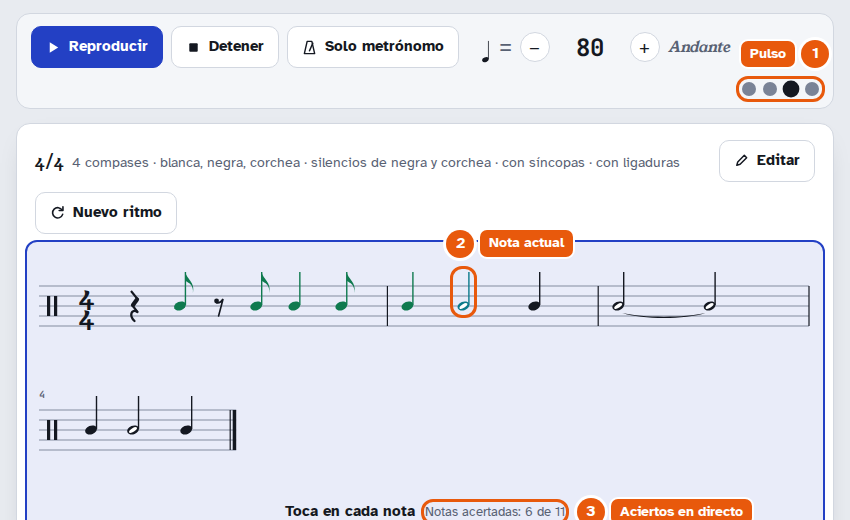

Al pulsar *Practicar* (o tocar la partitura), la partitura se enmarca en azul y suena la cuenta previa (el número aparece sobre la partitura). Después, **toca en cada nota**: sobre la partitura con el dedo o el ratón, o con la barra espaciadora o cualquier tecla menos <kbd>Esc</kbd>, que termina la práctica. Mientras practicas, <kbd>P</kbd>, <kbd>R</kbd> y <kbd>N</kbd> también cuentan como toques; solo funcionan como atajos fuera de la práctica.

1. **Pulso:** las luces siguen al metrónomo.
2. **Nota actual:** el cursor marca la nota que suena; las que ya tocaste se colorean según tu precisión.
3. **Aciertos en directo:** cuántas notas llevas.

Si el ritmo ocupa varias líneas, la página se desplaza sola para que siempre veas la línea que suena y la siguiente. En los silencios y en las notas ligadas no se toca.

### 5. Revisa el resultado

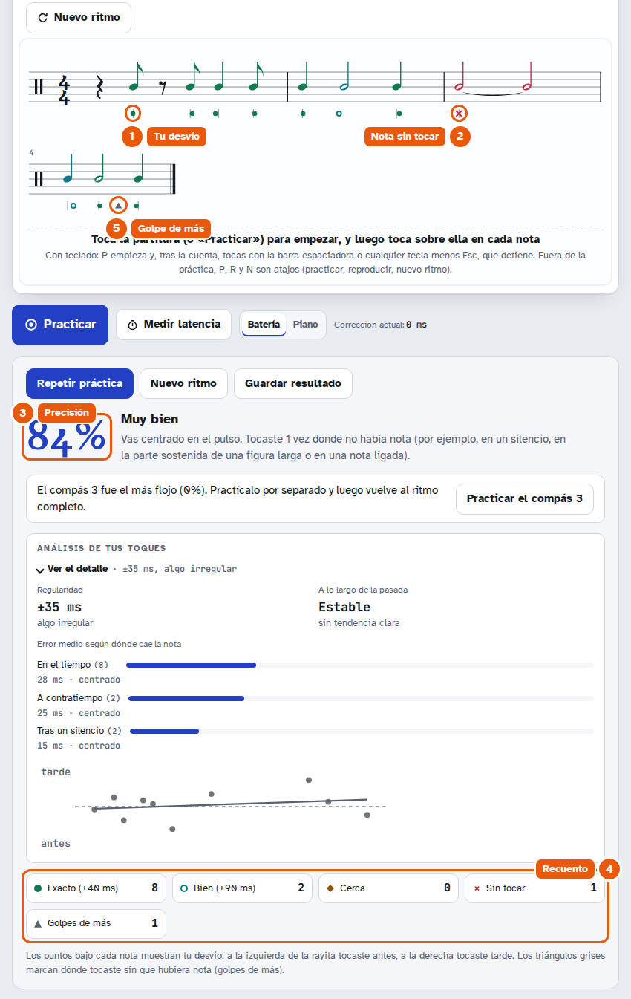

Los botones para repetir la práctica o pedir un nuevo ritmo quedan arriba, junto a la partitura.

1. **Tu desvío:** el marcador bajo cada nota indica si tocaste antes (a la izquierda de la rayita) o tarde (a la derecha). Círculo verde = exacto (±40 ms), anillo azul verdoso = bien (±90 ms), rombo naranja = cerca.
2. **Nota sin tocar:** una ✕ roja.
3. **Precisión:** la nota global, con un consejo (si tiendes a adelantarte o atrasarte).
4. **Recuento:** exactas, bien, cerca, sin tocar y golpes de más.
5. **Golpe de más:** un triángulo gris marca dónde tocaste sin que hubiera nota (en un silencio, en la parte sostenida de una figura larga o en una nota ligada).

Debajo, el bloque **Análisis de tus toques** resume cómo tocaste: tu *regularidad* (cuánto se dispersan tus toques, en ms), si *aceleras o te retrasas* a lo largo de la pasada, el error medio *a tiempo*, *a contratiempo* y *tras un silencio*, una pequeña gráfica del desvío de cada nota y, si hay un patrón claro, un consejo concreto. Aunque toques notas muy rápidas siempre un poco tarde, la app reconoce a qué nota iba cada toque y te dice que vas tarde, no que te adelantas.

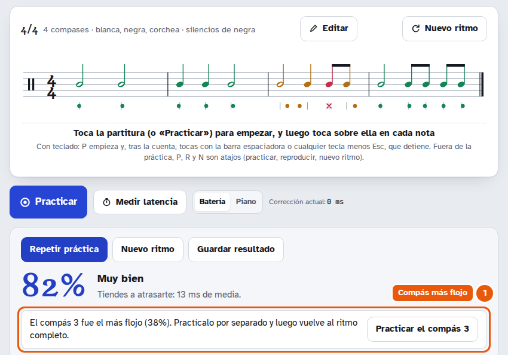

1. **Compás más flojo:** si el ritmo tiene varios compases y alguno baja del 90 %, el resultado lo indica y ofrece *Practicar el compás N*: se practica solo ese compás, tal cual, hasta que salga. *Ritmo completo* (junto a *Nuevo ritmo*) vuelve al ritmo entero. En la campaña, practicar un compás suelto no cuenta para las estrellas del nivel.

#### En modo piano

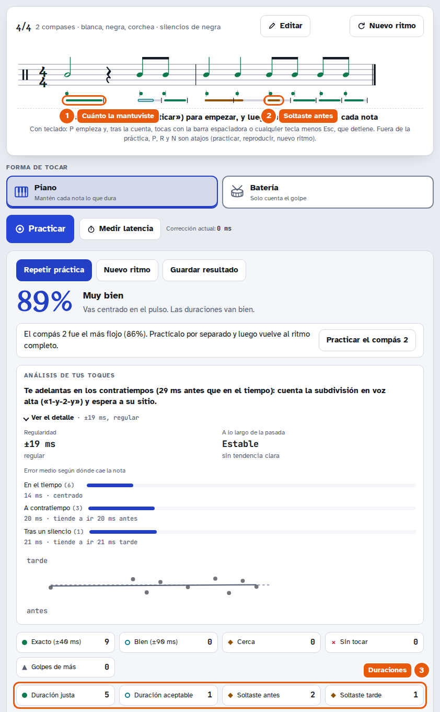

Además del ataque se mide cuándo sueltas cada nota.

1. **Barra de duración:** compara cuánto la mantuviste (color) con lo que debía durar (gris); la rayita marca dónde tenías que soltar.
2. **Soltaste antes:** la barra se queda corta y en naranja.
3. **Duraciones:** justas, aceptables, antes y tarde, con un consejo si sueles soltar pronto o tarde.

### 6. Medir la latencia

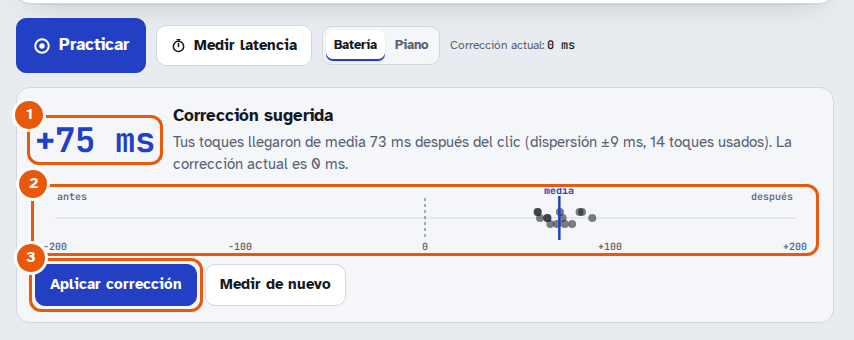

Si siempre te marca «tarde» aunque vayas a tiempo (pasa a menudo con auriculares Bluetooth), pulsa **Medir latencia**: suenan 4 clics de cuenta y tocas con los 16 siguientes.

1. **Corrección sugerida:** cuántos milisegundos llegan tarde tus toques de media.
2. **Cada toque:** dónde cayó cada uno respecto al clic.
3. **Aplicar corrección:** la guarda como *Ajuste de latencia*.

### 7. Campaña

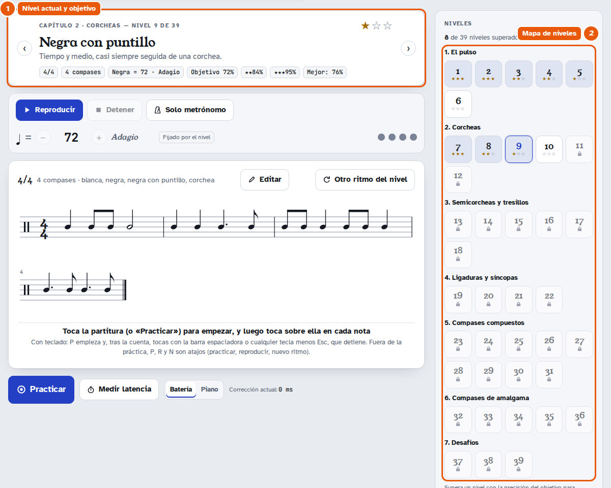

1. **Nivel actual:** qué se practica, compás, tempo fijo (con la figura a la que va, p. ej. «Negra con puntillo = 50 · Largo»; el control de tempo muestra «Fijado por el nivel») y la precisión necesaria para 1, 2 y 3 estrellas. El término italiano sale del pulso real: en 7/8 con la corchea a 150 es *Larghetto*, no *Allegro*.
2. **Mapa de niveles:** 39 niveles en 7 capítulos: *El pulso*, *Corcheas* (con el compás partido 2/2 y el 3/2), *Semicorcheas y tresillos* (con el ritmo lombardo), *Ligaduras y síncopas*, *Compases compuestos* (6/8, 9/8, 12/8, 3/8 y el dosillo), *Compases de amalgama* (5/8, 7/8 y 8/8 con distintas agrupaciones) y *Desafíos*. Cada nivel se desbloquea al conseguir al menos una estrella en el anterior, y uno que ya superaste o intentaste sigue abierto. Los silencios, incluido el de compás entero, se introducen poco a poco, y cada ritmo de un nivel usa todas las figuras y la celda que ese nivel enseña.

Al cambiar de nivel, la partitura se centra en la pantalla.

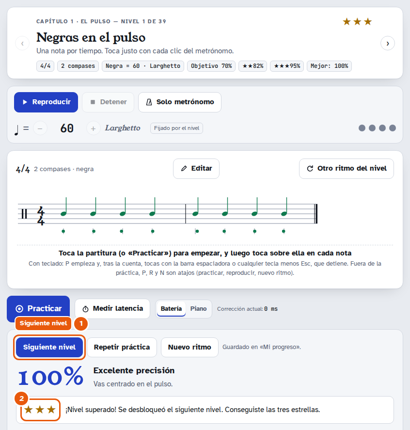

1. **Siguiente nivel:** aparece, como botón principal, cuando superas el nivel.
2. **Estrellas** conseguidas y lo que falta para la siguiente.

### 8. Mis ejercicios

Para escribir tus propios ejercicios, guardarlos y compartirlos.

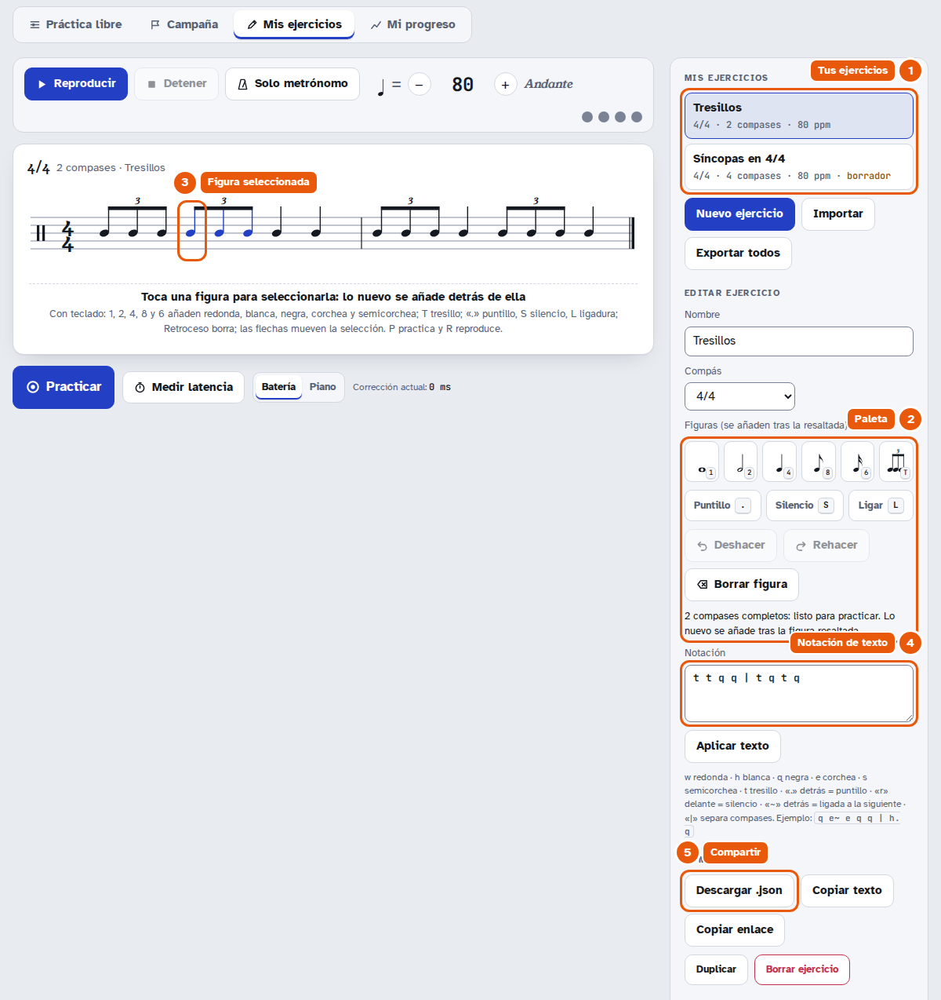

1. **Tus ejercicios:** la lista, con su compás, compases, tempo y tu mejor resultado (o *borrador* si falta completarlo).
2. **Paleta:** figuras, *Puntillo*, *Silencio* y *Ligar*, deshacer, rehacer y borrar.
3. **Figura seleccionada:** tócala en la partitura; lo nuevo se añade detrás.
4. **Notación de texto:** el mismo ejercicio escrito con letras; se puede editar y aplicar.
5. **Compartir:** archivo .json, texto o enlace.

- **Crear:** si aún no tienes ninguno, la pestaña abre directamente uno nuevo y vacío. Después, *Nuevo ejercicio*, o *Editar* sobre un ritmo de Práctica libre o de la campaña para copiarlo y cambiarlo. Eliges nombre, compás (y agrupación en amalgama); el tempo se guarda con cada ejercicio.
- **Escribir figuras:** con la paleta (redonda, blanca, negra, corchea, semicorchea y tresillo, más *Puntillo*, *Silencio* y *Ligar*) o con el teclado: <kbd>1</kbd> <kbd>2</kbd> <kbd>4</kbd> <kbd>8</kbd> <kbd>6</kbd> para las figuras, <kbd>T</kbd> tresillo, <kbd>.</kbd> puntillo, <kbd>S</kbd> silencio, <kbd>L</kbd> ligadura, <kbd>Retroceso</kbd> borra, flechas para moverte, <kbd>Ctrl</kbd>+<kbd>Z</kbd> / <kbd>Ctrl</kbd>+<kbd>Y</kbd> deshacer y rehacer. Toca una figura de la partitura para seleccionarla: lo nuevo se añade detrás.
- **Compases:** si una nota no cabe en el compás, se parte sola con ligaduras según el pulso (un silencio, en silencios). Si escribes algo que tapa el pulso, la figura se marca en otro color y aparece *Reescribir según el pulso*, que lo arregla (se puede deshacer y no impide practicar). Para practicar, todos los compases deben estar completos; mientras tanto el ejercicio queda como *borrador*.
- **Notación de texto:** también puedes escribirlo directamente: `w` redonda, `h` blanca, `q` negra, `e` corchea, `s` semicorchea, `t` tresillo; `.` detrás para el puntillo, `r` delante para el silencio, `~` detrás para ligar con la siguiente y `|` entre compases; `rw` es el silencio de compás entero en cualquier compás. Por ejemplo: `q e~ e q q | h. q`.
- **En el móvil:** mientras editas, la paleta queda fija abajo de la pantalla, con el estado del compás y un botón *Practicar*, para escribir sin desplazarte hasta el panel. Se aparta al escribir en un campo (nombre, notación), al practicar y con los resultados a la vista.

  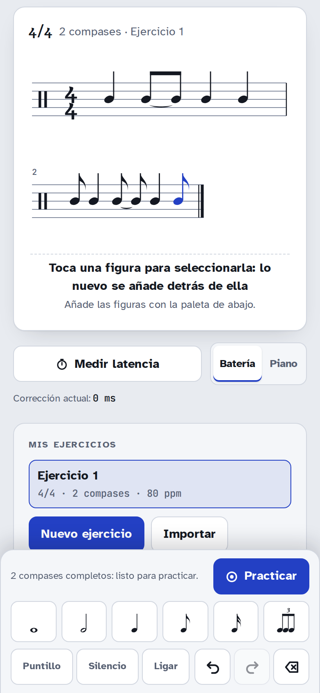

- **Avisos:** los mensajes (copiado, importado, borrado…) salen en un aviso flotante que se quita solo.
- **Guardar:** cada cambio se guarda solo en el navegador (hasta 200 ejercicios). Las prácticas aparecen en *Mi progreso* con el nombre del ejercicio (filtro *Propios*) y no dan estrellas.
- **Compartir:** *Descargar .json* (o *Exportar todos*), *Copiar texto* (nombre, compás y tempo, y la notación) o *Copiar enlace*. *Importar* acepta los tres: un archivo, el texto pegado o el enlace; al abrir un enlace, el ejercicio se añade a tu lista. El enlace lleva el ejercicio dentro y solo usa caracteres que no cortan los navegadores ni WhatsApp; si pasa de 2000 caracteres (unos 40 compases muy densos), la app propone el archivo o el texto.

### 9. Mi progreso

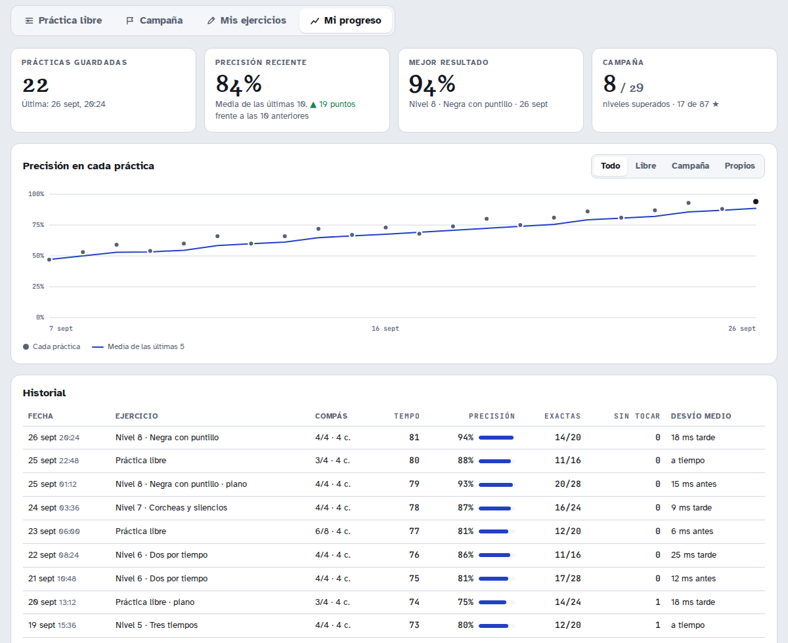

Resumen de tus prácticas, gráfica de precisión con la media de las últimas cinco e historial detallado (incluye la agrupación en los compases de amalgama y tu regularidad). En el móvil el historial se ve como tarjetas y la gráfica se consulta tocando un punto.

### En el móvil

<p>
  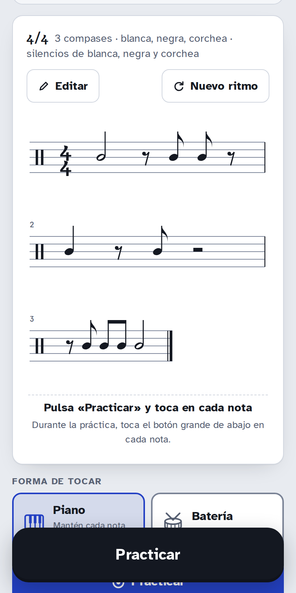
  &nbsp;
  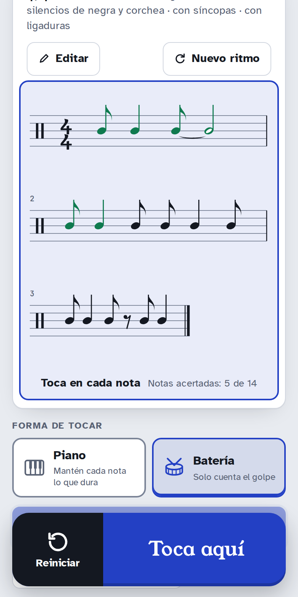
  &nbsp;
  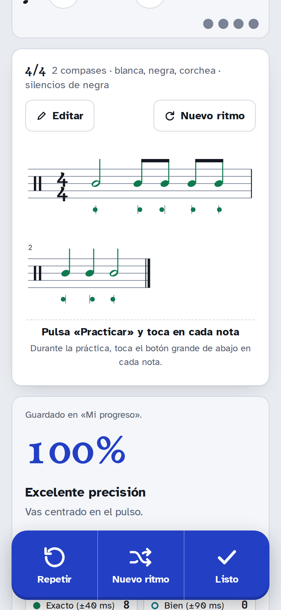
</p>

En pantallas pequeñas el panel de opciones pasa debajo de la partitura. En móvil y tableta aparece un **botón grande abajo de la pantalla** mientras la partitura está a la vista:

- **En reposo** dice *Practicar* y empieza la práctica (izquierda). Solo aparece si el botón *Practicar* de la página no está a la vista.
- **Mientras suena** *Reproducir* o *Solo metrónomo* dice *Detener*.
- **Durante la práctica** dice *Toca aquí* y es donde tocas (centro): no se mueve cuando la partitura cambia de línea, así no tocas fuera por error. Muestra la cuenta previa y, en modo piano, se mantiene pulsado.
- **Mientras practicas o mides la latencia**, el tercio izquierdo del botón es *Reiniciar*: mantenlo pulsado medio segundo (se va llenando) para empezar de nuevo sin ver resultados. Un toque corto no hace nada, así que no reinicias por error. El botón *Practicar* de la página queda deshabilitado mientras tanto.
- **Al terminar** se divide en tres (derecha): *Repetir*, *Nuevo ritmo* y, a la derecha, *Siguiente* en la campaña (lleva al siguiente nivel; aparece apagado si no lo has superado) o *Listo* en práctica libre (cierra los resultados y limpia las marcas de la partitura).

Con los resultados a la vista, en el móvil quedan pegados a la partitura, con el porcentaje y las estrellas por encima del botón, y el detalle del análisis plegado. Si cambias una opción del panel con la partitura fuera de la vista, un aviso *Ritmo nuevo · Ver ↑* te lleva a ella. Todos los controles táctiles miden al menos 44 px y, en pantallas bajas, el botón flotante es más bajo.

Si prefieres tocar sobre la partitura, desactívalo en *Práctica → Botón flotante para tocar*.

En *Mis ejercicios*, mientras editas, en lugar del botón *Practicar* aparece abajo la paleta de figuras (ver el apartado 8).

### Teclado

- <kbd>P</kbd>: practicar (también <kbd>Espacio</kbd> o <kbd>Enter</kbd> con la partitura enfocada).
- <kbd>R</kbd>: reproducir.
- <kbd>Esc</kbd>: detener (en la práctica, termina y muestra el resultado; si aún no has tocado nada, por ejemplo durante la cuenta, para sin resultados).
- <kbd>Espacio</kbd> o cualquier tecla: tocar durante la práctica o la medición de latencia.
- <kbd>N</kbd>: nuevo ritmo.
- En las pestañas, <kbd>←</kbd> <kbd>→</kbd>, <kbd>Inicio</kbd> y <kbd>Fin</kbd> cambian de sección.

Los atajos de una tecla no actúan con el foco en un botón o una pestaña y se pueden desactivar (*Práctica → Atajos de teclado de una tecla*). *Reiniciar* también funciona con <kbd>Intro</kbd> o <kbd>Espacio</kbd>.

**Accesibilidad:** la app anuncia a los lectores de pantalla el inicio de la práctica, el resultado y la medición de latencia, y al terminar lleva el foco a los resultados. La partitura se lee en palabras («Compás 1: negra, dos corcheas, negra, negra»), los niveles con su título, sus estrellas y su estado, y un enlace *Saltar a la partitura* abre la página. El foco no se pierde al cambiar opciones ni queda tapado por los botones fijos, los marcadores se distinguen también por su forma y se respetan *movimiento reducido* y los colores forzados del sistema.

### Otros detalles

- **Primera vez:** una tarjeta explica cómo se practica, presenta las demás pestañas y ofrece medir la latencia. Desaparece al pulsar *Entendido* o al terminar la primera práctica.
- **Opciones plegables:** *Reproducción*, *Metrónomo* y *Práctica* se pliegan (en el móvil empiezan plegadas) y la app recuerda cómo las dejaste. Al final del panel, *Restablecer ajustes* vuelve a las opciones iniciales sin tocar tu progreso ni la corrección de latencia.
- **Avisos:** si el navegador no deja guardar datos (modo privado, almacenamiento lleno) o no puede reproducir audio, aparece un aviso arriba.
- **En pantallas táctiles,** si el dispositivo lo permite, cada toque vibra (*Práctica → Vibrar al tocar*).
- **Precisión del tiempo:** la hora de cada toque se toma del propio evento y se compara con lo que sonaba en ese momento, descontando la latencia de los altavoces o auriculares; el audio se programa compás a compás, así que funciona igual con ritmos largos.
- **Detener sin resultados:** si detienes antes de tocar nada (por ejemplo, durante la cuenta previa), no se guarda ninguna práctica ni se gasta un intento de la campaña.
- **Seguridad y privacidad:** no hay cuentas ni servidor; los ajustes, el progreso y los ejercicios se guardan solo en tu navegador, se validan al leerlos y la página tiene una política de seguridad estricta. Detalles y cómo avisar de un problema en [`SECURITY.md`](SECURITY.md).

## Pruebas

La app no necesita nada para funcionar, pero tiene una batería de pruebas de navegador en `tests/` (Playwright + Chromium, más de 700 comprobaciones: tiempo y audio, notación según el pulso, campaña, Mis ejercicios, accesibilidad, seguridad, móvil, análisis del estudiante, audio en iOS y cobertura de figuras en la campaña). Hace falta Node 22 o superior:

```
npm install                       # instala Playwright (solo para las pruebas)
npx playwright install chromium   # descarga el navegador (una vez)
npm test                          # equivale a: node tests/run.js
```

`node tests/run.js ej dock` ejecuta solo las suites cuyo nombre de archivo contiene «ej» o «dock», y `node tests/ej.test.js` una sola suite. El proceso termina con código distinto de 0 si falla alguna comprobación. Las pruebas copian `index.html`, `styles.css`, `js/` y `fonts/` a una carpeta temporal, sirven esa copia en `127.0.0.1` y no necesitan red. En GitHub se ejecutan solas con cada *push* y *pull request* (`.github/workflows/tests.yml`).

Para el detalle técnico, consulta [`CLAUDE.md`](CLAUDE.md).
